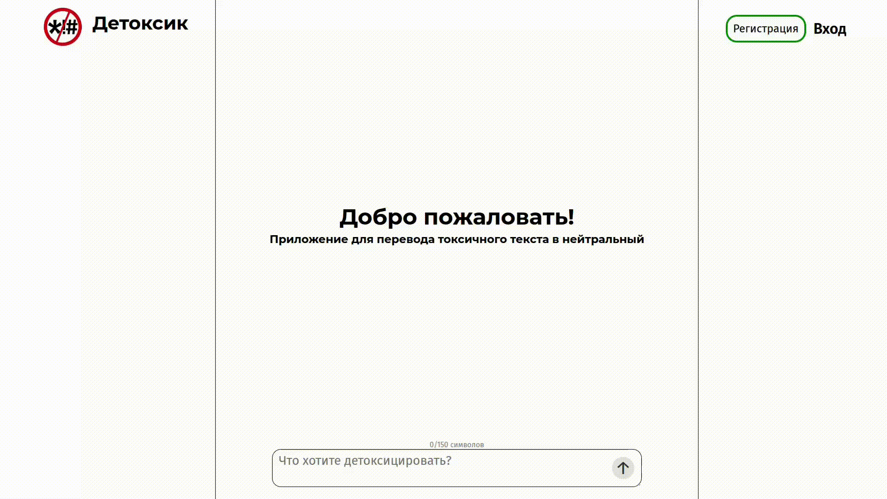
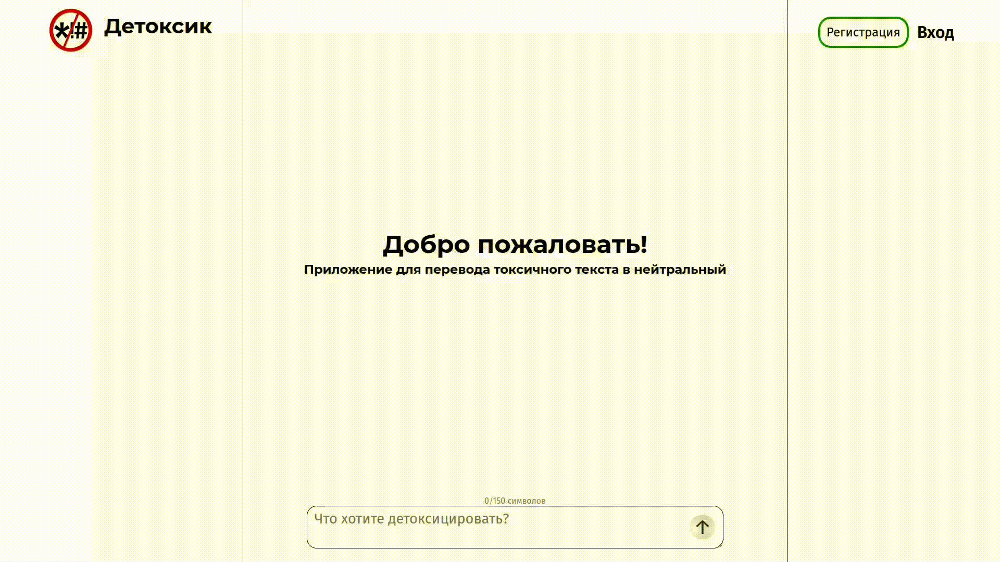
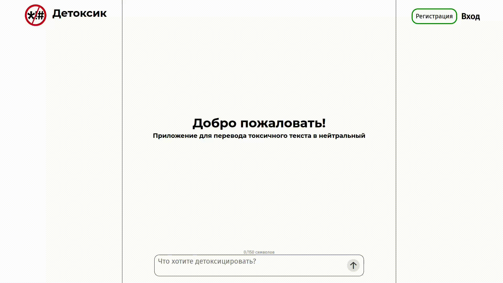

**Веб приложение "Детоксик"**  
-
Реализует автоматическое преобразование токсичных сообщений на русском языке в нейтральные, с помощью алгоритмов глубокого обучения

---
**Демонстрация работы**
-
1. Преобразование токсичного текста  

2. Создание личного кабинета с хранением истории запросов

3. Авторизация с помощью OAuth

---
**Функциональные возможность**
-
- Отправка токсичного текста на преобразование в нейтральный (до 150 символов)
- Генерация нейтрального текста на основе токсичного
- Анализ преобразованного текста на токсичность
- Сравнение смысловой схожести оригинального и сгенерированного сообщений
- Регистрация с подтверждением по email
- Авторизация через сторонние сервисы: Yandex, Google, GitHub
- Сохранение истории запросов авторизованного пользователя
- Кэширование последних сообщений, для повышения скорости ответа  
- 
---
**Стек технологий**
-
- **Backend:** Python, Flask
- **Модели машинного обучения (Hugging Face):**
  - `nllb-200-distilled-600M` — дообучена на датасете `u_paradetox_content` для нейтрализации текста
  - `russian_toxicity_classifier` — оценка токсичности
  - `gte-multilingual-base` — оценка семантической схожести
- **Frontend:** HTML, CSS, JS
- **База данных:** MySQL
- **Кэширование:** Redis
- **Инфраструктура развертывания:** Docker, Docker Compose

---
**Инструкция по запуску**
-
**Вариант 1: Через Docker (рекомендуется)**
1. Клонируйте репозиторий:
   ```bash
   git clone https://github.com/VL1D904/detox_app
   cd detox_app
    ```
2. Настройте переменные окружения:
    ```bash
   cp .env.template .env
    ```
3. Запустите контейнеры
    ```bash
   docker compose up --build
    ```
4. Откройте в бразуере: http://127.0.0.1:8000 

**Вариант 2: Локальный запуск**  
Требования: Python 3.10+, MySQL, Redis  
1. Клонируйте репозиторий:
   ```bash
   git clone https://github.com/VL1D904/detox_app
   cd detox_app
    ```
2. Создайте виртуальное окружение и установите зависимости
    ```bash
   python -m venv .venv
   source .venv/bin/activate #Linux
   .venv\Scripts\activate #Windows
   pip install -r requirements.txt
    ```
3. Заполните .env на основе .env.template
4. Выполните скрипт загрузки моделей
    ```bash
   python load_models.py
    ```
5. Запустите приложение
    ```bash
   gunicorn --bind 127.0.0.1 --workers 1 wsgi:app 
    ```
6. Откройте в бразуере: http://127.0.0.1:8000 
